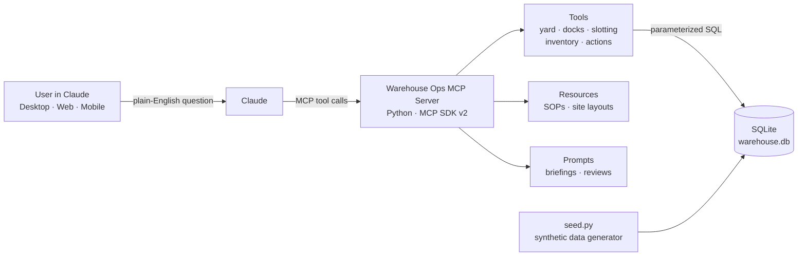

# Warehouse Ops MCP

**An AI assistant for distribution center operations.** This [Model Context Protocol](https://modelcontextprotocol.io) server lets Claude analyze yard, dock, slotting, and inventory data and answer operations questions in plain English.

> "Which trailers have been in the CHI1 yard more than 48 hours, and what should we do about each one?"
>
> Claude calls `get_long_dwell_trailers`, finds two loaded inbound trailers that have sat untouched for nearly a week, and recommends prioritizing them for a door ahead of four empties waiting on carrier pickup.


---

## Why this project

Distribution center supervisors answer the same questions every shift: *What's sitting in the yard too long? Which doors are free? Are our fastest SKUs in the right slots? What's about to run out?* The answers usually live in several systems and spreadsheets.

This project puts those questions behind a conversational interface. Claude decides which tools to call, chains them together, and returns a prioritized action list grounded in the data, following the site's own SOPs.

All data is **synthetic**: two fictional DCs, fictional carriers, and generated SKUs. No real company data is used.

## What it can do

| Area | Tool | Answers |
|---|---|---|
| Sites | `list_sites` | What sites exist? |
| Yard | `get_yard_status` | What's on site right now, by status and load? |
| Yard | `get_long_dwell_trailers` | Which trailers have been here too long, and what's the next action? |
| Yard | `get_trailer_history` | Where has this trailer been, move by move? |
| Docks | `get_door_status` | Which doors are open, occupied, or out of service? |
| Docks | `get_dock_utilization` | How busy was each door on a given day? Which sat idle? |
| Docks | `get_upcoming_appointments` | What's arriving next? Is any door double-booked? |
| Slotting | `get_sku_velocity` | How fast is this SKU moving, and is it trending? |
| Slotting | `get_slotting_candidates` | Which fast movers are in poor slots, and what should they swap with? |
| Slotting | `explain_slot` | Is this SKU in the right location, and why? |
| Slotting | `get_demand_trends` | Which SKUs are rising or fading this month? |
| Inventory | `find_sku` | Find a SKU by code, description, or category |
| Inventory | `get_sku_inventory` | Where is the stock, and how many days of supply? |
| Inventory | `get_replenishment_needs` | Which pick faces will run out within two days? |
| Inventory | `get_location_contents` | What's stored in this location? |
| Actions | `list_trailer_flags` | What's on the yard team's worklist? |
| Actions | `flag_trailer_for_pull` | Flag a trailer to be moved *(write, local mode only)* |
| Actions | `resolve_trailer_flag` | Close a flag once handled *(write, local mode only)* |

**Resources** (reference material Claude can read):
- `warehouse://sites/{site_id}/layout`: zones, aisles, dock doors, yard
- `warehouse://sops/yard-management`: dwell thresholds and door priority rules
- `warehouse://sops/slotting`: slotting principles and per-shift move limits

**Prompts** (one-click workflows that chain several tools):
- `daily_yard_briefing(site_id)`: shift briefing with prioritized actions
- `slotting_review(site_id, days)`: re-slot plan with walking time saved

## Architecture



The server runs in two modes:

| Mode | Transport | Used by | Write tools |
|---|---|---|---|
| Local | stdio | Claude Desktop, Claude Code | Enabled |
| Remote | Streamable HTTP | claude.ai custom connector (web and mobile) | Disabled (not exposed) |

## Safety and guardrails

Giving an AI agent access to operational data raises a fair question: how do you keep it from doing something harmful? This server uses several layers:

- **Read-only by default.** Read tools open the database in read-only mode, and every query is parameterized.
- **Honest tool annotations.** Each tool declares whether it reads or writes, so clients can require approval for writes.
- **Validated writes.** Flagging checks that the trailer is on site, requires a meaningful reason, and blocks duplicate open flags.
- **Audit trail.** Every flag and resolution records who, when, and why. Nothing is ever deleted.
- **Mode-aware permissions.** Write tools are not registered when the server runs remotely, so a public endpoint can only read.
- **Helpful errors.** Expected problems (unknown site, bad date) return a clear message Claude can correct from; unexpected errors stay hidden.

## How the analytics work

**Synthetic data.** `data/seed.py` simulates 90 days across two DCs: about 3,600 trailer visits, 14,000 yard moves, 2,200 appointments, 600 SKUs, 3,000 storage locations, and 50,000 pick lines. It models:

- Event-based yard flow (gate in → yard → door → yard → gate out), with doors holding one trailer at a time so queues form naturally
- Live and drop trailers, plus a small share of "forgotten" trailers with multi-day dwell
- Pareto demand, where the top 20% of SKUs drive about 70% of picks
- Slotting drift (fast movers misplaced over time) and demand shifts (rising and fading SKUs)

Timestamps anchor to the current time on every run, so "the last 48 hours" always has answers.

**Velocity-based slotting.** SKUs are ranked by pick lines over a window (default 30 days). Pick locations are ranked by a quality score: travel distance from pick start plus a penalty for slots outside the golden zone (waist-to-shoulder height). A fast mover whose current slot is much worse than the slot its rank deserves is paired with a slow mover occupying a prime slot, and the swap is scored by net walking distance saved per day.

**Replenishment.** Days of supply = pick-face quantity ÷ average daily units over the last 14 days. Pick faces under 2 days are flagged with the reserve location to pull from, or marked as having no reserve stock.

## Quick start

Requires Python 3.11+ and [uv](https://docs.astral.sh/uv/).

```bash
git clone https://github.com/hetvishah18-bit/warehouse-ops-mcp.git
cd warehouse-ops-mcp
uv sync
uv run python data/seed.py     # build data/warehouse.db
uv run python data/verify.py   # sanity-check the data
uv run pytest                  # 29 tests
```

### Connect to Claude Desktop (local mode)

Add this to `claude_desktop_config.json` (**Settings → Developer → Edit Config**), using the full path to `uv` (from `which uv`) and to this folder:

```json
{
  "mcpServers": {
    "warehouse-ops": {
      "command": "/full/path/to/uv",
      "args": ["--directory", "/full/path/to/warehouse-ops-mcp", "run", "warehouse-ops-mcp"]
    }
  }
}
```

Restart Claude Desktop, then try *"Give me a yard briefing for CHI1."*

### Run remotely (HTTP mode)

```bash
uv run warehouse-ops-mcp --transport http --port 8000
# MCP endpoint: http://localhost:8000/mcp
```

Or with Docker, which reseeds fresh data on every start:

```bash
docker build -t warehouse-ops-mcp .
docker run -p 8000:8000 warehouse-ops-mcp
```

Deployed to Render, the server can be added to claude.ai as a custom connector (**Settings → Connectors → Add custom connector**) using the deployed URL ending in `/mcp`.

## Project structure

```
warehouse-ops-mcp/
├── data/
│   ├── schema.sql            # 11 tables + indexes
│   ├── seed.py               # synthetic data generator
│   └── verify.py             # data sanity checks
├── src/warehouse_ops/
│   ├── server.py             # server factory, stdio/HTTP entry point
│   ├── db.py                 # read-only queries, write helper, validation
│   ├── tools/                # yard, docks, slotting, inventory, actions
│   ├── resources/            # site layout + SOP markdown
│   └── prompts/              # briefing and review workflows
├── tests/                    # 29 tests: unit, MCP client, write guardrails
├── Dockerfile
└── pyproject.toml
```

## Example questions

- "Give me a yard briefing for both sites."
- "How busy were SOC1's inbound doors yesterday? Any idle doors?"
- "Run a slotting review for CHI1. What are the top moves, and how much walking time would they save?"
- "Is TRF-00024 in the right location at CHI1? Why or why not?"
- "Which SKUs are about to run out in the pick face, and where's the reserve stock?"
- "Flag the loaded inbound trailers over 100 hours as urgent." *(local mode)*

## Possible next steps

- OAuth so the remote server can safely enable write tools per user
- Cube- and weight-aware slotting (heavy items at floor level)
- Connectors to real WMS and YMS data sources in place of synthetic data
- Labor forecasting from pick volume trends

## About

Built by **Hetvi Shah**, inspired by yard and slotting problems seen in distribution center operations. All data in this repository is synthetic.
